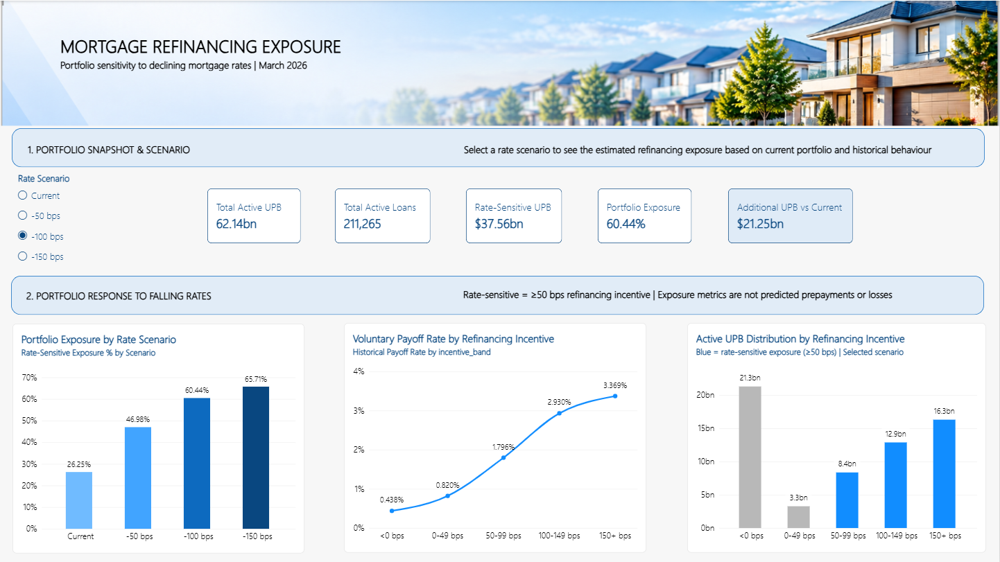
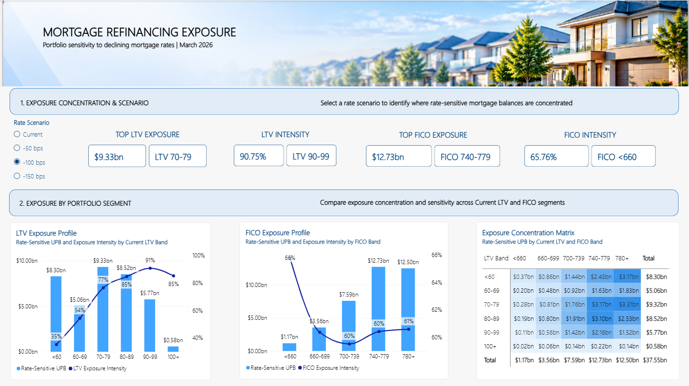
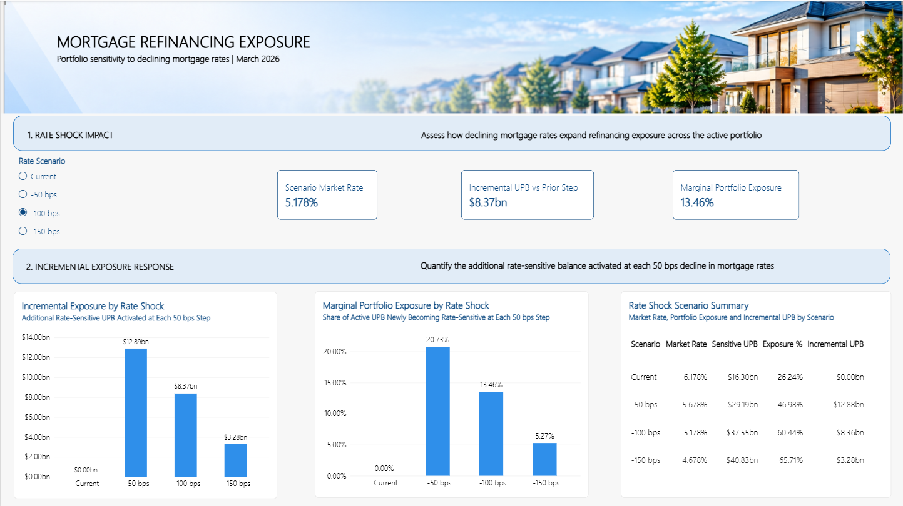

# Mortgage Refinancing Exposure Analytics

**End-to-End Data Analytics Project | Python • SQL • Power BI**

## Project Overview

This project examines how changes in prevailing mortgage rates may affect voluntary prepayment behaviour and refinancing-sensitive exposure within a US mortgage portfolio.

Using Freddie Mac Single-Family Loan-Level Dataset samples and the Primary Mortgage Market Survey (PMMS), the analysis investigates historical borrower behaviour, identifies rate-sensitive outstanding mortgage balances, and evaluates hypothetical interest rate decline scenarios.

The project focuses on **portfolio exposure analytics rather than individual borrower prepayment prediction**.

## Business Questions

1. How does voluntary payoff behaviour change as refinancing incentives increase?
2. How much active mortgage unpaid principal balance (UPB) becomes rate-sensitive under hypothetical declines in market mortgage rates?
3. Which portfolio segments contain the highest concentration of rate-sensitive exposure?

## Tools & Technologies

- **Python:** Pandas, NumPy, Matplotlib, Seaborn - data preparation, validation, statistical exploration and refinancing scenario analysis.
- **SQL:** Data querying, transformation and analytical reporting.
- **Power BI:** Interactive dashboards, KPI visualisation and portfolio exposure reporting.

## Data Sources

- Freddie Mac Single-Family Loan-Level Dataset - sample origination vintages from 2019 to 2025.
- Freddie Mac Primary Mortgage Market Survey (PMMS) - 30-year fixed-rate mortgage benchmark.

The analytical population is restricted to 30-year fixed-rate mortgages to maintain comparability with the selected market-rate benchmark.

## Methodology - End-to-End Analytical Workflow

### Phase 1 - Python: Data Preparation & Exploratory Analysis

- Prepare and validate Freddie Mac mortgage origination and monthly performance data.
- Analyse historical voluntary prepayment behaviour and refinancing incentives.
- Evaluate mortgage portfolio exposure under hypothetical interest rate decline scenarios.
- Segment exposure by LTV, FICO score and origination vintage.

### Phase 2 - SQL: Analytical Validation & Querying

- Query and validate the prepared analytical datasets.
- Analyse historical prepayment patterns and active mortgage portfolio characteristics.
- Examine rate-sensitive exposure across interest rate scenarios.
- Aggregate exposure metrics across portfolio segments.

### Phase 3 - Power BI: Dashboard & Business Reporting

- Develop interactive portfolio exposure dashboards.
- Visualise exposure concentration across mortgage segments.
- Present management-oriented insights to support portfolio monitoring and scenario analysis.

The three components form an integrated analytical workflow, connecting data preparation, SQL-based analysis and interactive business reporting.

## Key Findings

**Historical prepayment behaviour**

Voluntary payoff rates generally increase as refinancing incentives strengthen. A positive refinancing incentive is associated with higher observed voluntary payoff rates, although this relationship is descriptive rather than causal.

**Current portfolio exposure - March 2026**

- Active mortgage loans: **211,265**
- Outstanding active UPB: approximately **$62.14 billion**
- Current rate-sensitive UPB: approximately **$16.31 billion (26.25%)**

**Interest rate decline scenarios**

| Scenario | Rate-sensitive UPB | Share of active UPB |
|---|---:|---:|
| Current market rate | $16.31B | 26.25% |
| -50 basis points | $29.20B | 46.98% |
| -100 basis points | $37.56B | 60.44% |
| -150 basis points | $40.84B | 65.71% |

These scenarios illustrate potential changes in refinancing-sensitive exposure, not forecasts of actual refinancing volumes or future interest rates.

**Portfolio segmentation**

Under the -100-basis-point scenario, the 70-79 estimated-LTV segment contains the largest dollar concentration of rate-sensitive exposure, while the 90-99 segment exhibits the highest exposure intensity.

## Project Structure

```text
mortgage-refinancing-exposure-portfolio/
├── README.md
├── .gitignore
├── python/
│   ├── README.md
│   └── Mortgage_Refinancing_Exposure_Analytics.ipynb
├── sql/
│   ├── README.md
│   └── Mortgage_Refinancing_Exposure_Analytics_SQL.ipynb
├── powerbi/
│   ├── README.md
│   ├── 01_portfolio_exposure.png
│   ├── 02_exposure_concentration.png
│   └── 03_management_insights.png
└── reports/
    ├── README.md
    ├── 1. Mortgage Refinancing Exposure Analytics- Python.pdf
    └── 1. Mortgage Refinancing Exposure Analytics - SQL.pdf
```

## Power BI Dashboard Preview

The Power BI dashboard was developed to present portfolio-level refinancing exposure, scenario sensitivity, and management insights. Screenshots of the completed dashboard are available below; the original `.pbix` file is not publicly distributed.

### 1. Portfolio Exposure

Overview of active mortgage balances, rate-sensitive exposure and hypothetical interest rate scenarios.



### 2. Exposure Concentration

Analysis of refinancing-sensitive exposure across mortgage portfolio segments.



### 3. Management Insights

Management-oriented insights for monitoring refinancing sensitivity and portfolio exposure.



## Project Status - Completed

- [x] Python data preparation and analytical modelling
- [x] Historical prepayment and refinancing exposure analysis
- [x] Interest rate scenario analysis
- [x] SQL analytical validation and querying
- [x] Power BI dashboard development
- [x] End-to-end analytical reporting

## Limitations

This project uses Freddie Mac publicly released sample data and should not be interpreted as representing Freddie Mac's entire mortgage portfolio.

Voluntary payoff is used as a proxy for prepayment behaviour and does not confirm that every payoff resulted from refinancing.

Rate-sensitive UPB measures exposure to refinancing incentives, not predicted repayments, prepayment volumes or financial losses.

The interest rate scenarios are hypothetical sensitivity tests rather than forecasts.

## Author

**Minh Khanh Trinh**

Aspiring Data Analyst | Python • SQL • Power BI

[GitHub Profile](https://github.com/minhkhanh-trinh3196)

## Reports & Documentation

Detailed analytical reports are available below:

- [Python Analysis Report](reports/1.%20Mortgage%20Refinancing%20Exposure%20Analytics-%20Python.pdf)
- [SQL Analysis Report](reports/1.%20Mortgage%20Refinancing%20Exposure%20Analytics%20-%20SQL.pdf)

These reports provide detailed analytical methodology, supporting results, and interpretations for the mortgage refinancing exposure study.

## Execution Environment & Reproducibility

This project was developed using Databricks for Python and SQL analysis, with Power BI for interactive dashboard reporting.

### Data Requirements

- Freddie Mac Single-Family Loan-Level Dataset samples (origination and monthly performance data, 2019-2025 vintages).
- Freddie Mac Primary Mortgage Market Survey (PMMS) 30-year fixed-rate mortgage benchmark data.
- Access to a configured Databricks environment and the required source datasets.

### Execution Workflow

1. Obtain the required datasets from Freddie Mac, subject to the applicable data access and usage terms.
2. Configure the source data paths in the Python notebook for your Databricks environment.
3. Execute the Python notebook to prepare and analyse the mortgage data and generate analytical outputs.
4. Configure the required analytical tables in Databricks SQL before executing the SQL notebook.
5. Explore the Power BI dashboard screenshots included in this repository to review portfolio exposure, scenario sensitivity, and management insights. The original Power BI `.pbix` file is not publicly distributed.

### Reproducibility Notes

- The notebooks use Databricks-specific storage paths and SQL functionality.
- Raw Freddie Mac source files and the Power BI project file containing loan-level data are not publicly distributed in this repository. Access to the underlying Freddie Mac datasets is subject to the applicable data usage terms.
- The analysis may require environment-specific configuration and access to the source datasets.
- The interest-rate scenarios are hypothetical sensitivity analyses, not forecasts of actual refinancing activity or financial losses.
